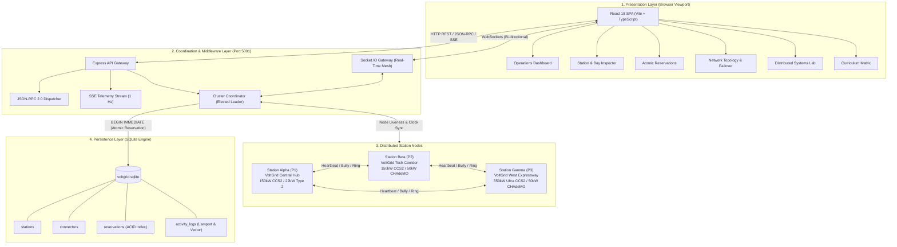
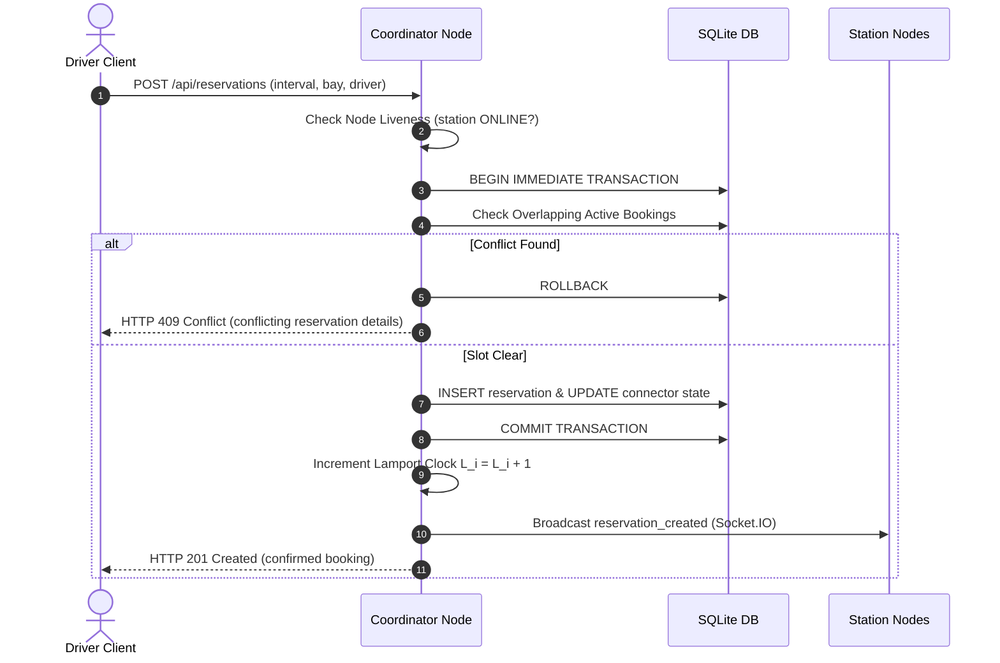
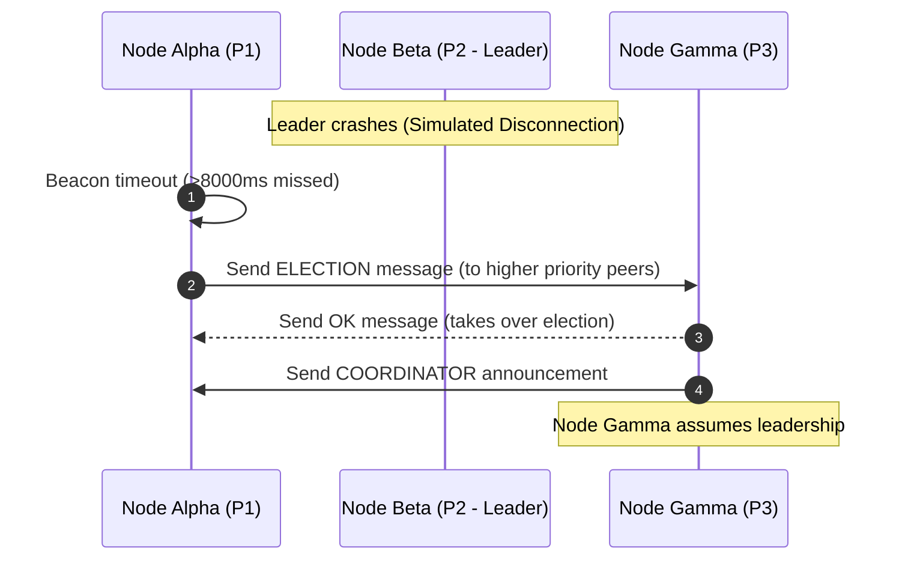

# VoltGrid System Architecture

## 1. Architectural Overview

**VoltGrid** is an educational, distributed coordination system designed for electric vehicle (EV) charging station networks. It models real-world distributed challenges: concurrent connector reservations, partial network partitions, asynchronous message passing, consensus leader election, and high-frequency sensor telemetry.

The system is partitioned into four primary layers:
1. **Driver Client Layer:** A full-screen, responsive React 18 single-page application with light/dark theme support and real-time WebSocket bindings.
2. **Coordination & API Gateway Layer:** Node.js/Express service providing REST endpoints, JSON-RPC 2.0 dispatching, and Server-Sent Events (SSE).
3. **Distributed Station Node Layer:** Autonomous simulated charging station nodes (`station-alpha`, `station-beta`, `station-gamma`), each maintaining independent operational status, priority, logical clocks, and heartbeat beacons.
4. **Persistence Layer:** Relational SQLite with strict ACID transaction guarantees (`BEGIN IMMEDIATE`), foreign key constraints, and WAL mode.

---

## 2. Mermaid Architecture Diagram

---

## 3. Component Responsibilities

### A. Driver Client (`client/`)
- Renders responsive operational views at common resolutions (1366×768 to 4K).
- Displays visual connector occupancy grids, latency counters, and logical clocks.
- Submits reservation intervals and executes interactive conflict injections.
- Receives instant state mutations via Socket.IO events (`heartbeat_tick`, `reservation_created`, `election_completed`).

### B. Coordination Service (`server/src/services/`)
- **Reservation Manager (`reservationService.ts`):** Validates timestamps and enforces interval overlap arithmetic `(new_start < existing_end) AND (new_end > existing_start)` inside atomic SQLite transactions.
- **Node Network Manager (`nodeNetwork.ts`):** Emulates independent station state machines, triggers heartbeat checks every 3000ms, and implements consensus election (Bully & Ring), Lamport logical clocks, vector clocks, and Ricart–Agrawala mutual exclusion.
- **JSON-RPC Dispatcher (`rpcService.ts`):** Implements specification-compliant JSON-RPC 2.0 error handling and procedure execution.

### C. Station Nodes
- Station nodes maintain their own:
  - Stable Node ID (`station-alpha`, `station-beta`, `station-gamma`).
  - Priority rank for Bully elections (Alpha = 1, Beta = 2, Gamma = 3).
  - Monotonic Lamport clock ($L_i$) and vector clock ($V_i$).
  - Heartbeat pulse timestamp and miss count.
  - Hardware connector bays and rated power capacities.

---

## 4. Communication Flows

### 1. Atomic Reservation Flow

### 2. Bully Election & Failover Flow

---

## 5. Independent Processes vs. Node Simulator Architecture

| Architectural Trait | Separate OS Processes | VoltGrid Structured Node Simulation |
| :--- | :--- | :--- |
| **Process Model** | 3 separate `node` instances on distinct OS ports. | Structured modular node instances managed by `NodeNetworkManager`. |
| **Communication** | TCP sockets across separate local ports. | In-memory message queue + Socket.IO network broadcast. |
| **Portability** | High risk of port conflicts and firewall blocks on student laptops. | 100% deterministic, zero setup friction, instant launch. |
| **Failure Simulation** | Requires sending OS `SIGKILL` or killing process. | Deterministic operator toggles in UI with live heartbeat timeout observation. |
| **Academic Fidelity** | High OS overhead. | Exactly models asynchronous message passing, priority bullies, vector clocks, and token circulation. |

*VoltGrid uses a structured station-node simulation module with independent state machines, explicit message queues, and node IDs, guaranteeing reproducible academic evaluation.*
